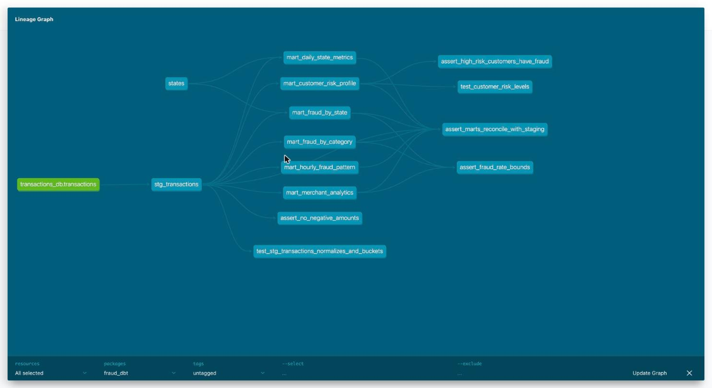

# dbt-проект поверх ClickHouse

ДЗ 4 по ML System Design. Модель данных по транзакциям из ДЗ 2 в каталоге dbt/: source -> staging -> marts.

## Версии

dbt-core 1.12.6, dbt-clickhouse 1.10.3, ClickHouse 24.8, пакеты dbt_utils, dbt_date, dbt_expectations, sqlfluff 4.4.0.

## Витрины

    stg_transactions             очистка, типы, ключи, календарь, amount_bucket
    mart_daily_state_metrics     дата x штат
    mart_fraud_by_category       фрод по категориям
    mart_fraud_by_state          фрод по штатам
    mart_customer_risk_profile   уровень риска клиента
    mart_hourly_fraud_pattern    фрод по дню недели и часу
    mart_merchant_analytics      мерчанты и флаг подозрительности

## Тесты

60 тестов, все проходят, лог - dbt/docs/dbt_test.log: not_null, unique, accepted_values, relationships, dbt_utils, dbt_expectations, 4 singular tests и 2 unit tests.

## Запуск

train.csv в data/:

    cd dbt
    make venv && make up && make all && make docs

Линтинг: dbt/.sqlfluff и .pre-commit-config.yaml, `make lint`.

## DAG

